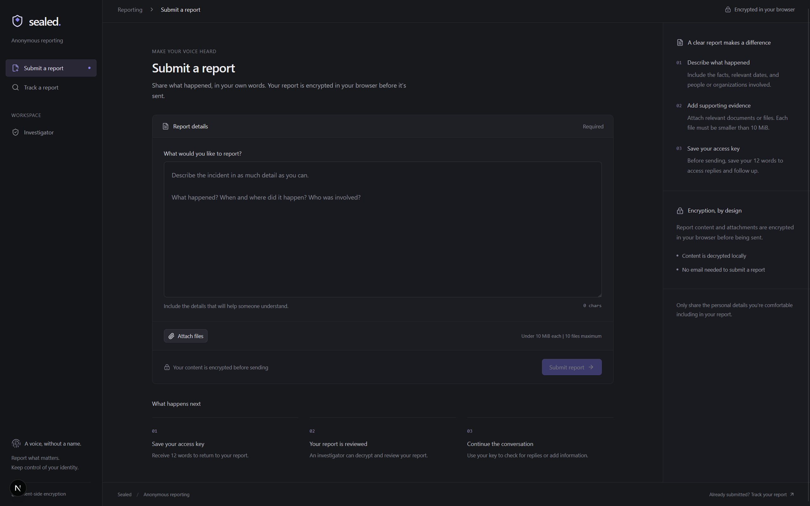
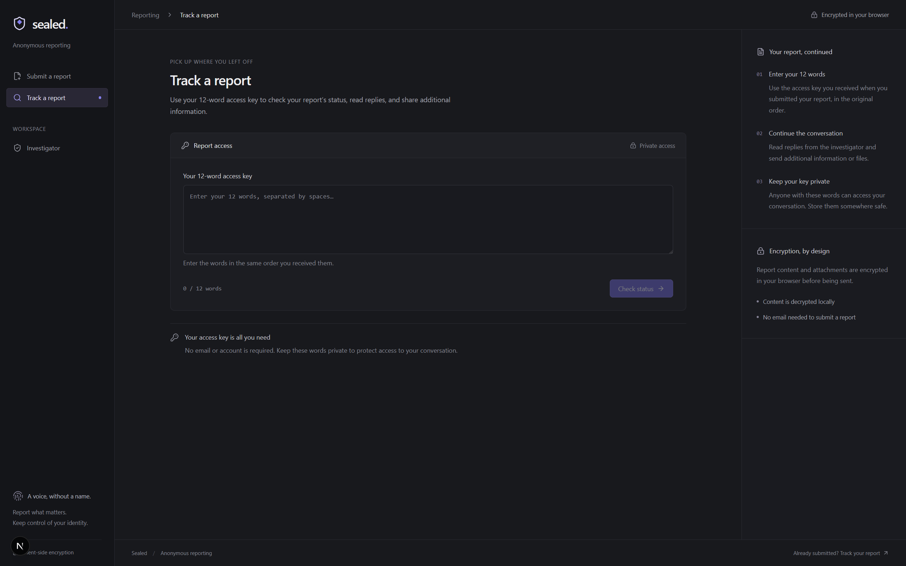
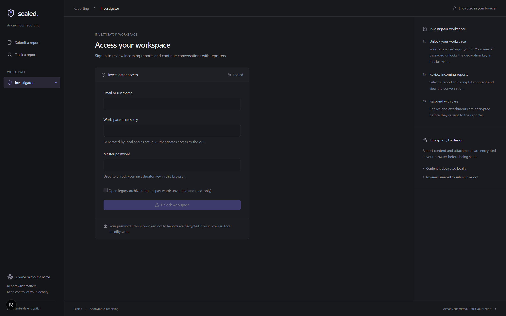

# Sealed

A local portfolio application for encrypted reporting and two-way conversations. Reports and attachments are encrypted in the browser; v2 messages are signed by independently established participant identities. Backend authentication, content signatures and server history checks serve different purposes.

[Demo guide](DEMO.md) · [Security model](MILESTONE_4_SECURITY_AUDIT.md) · [Verification report](MILESTONE_4_REPORT.md)

**Current milestone: M4 — security, integrity and finalization.** The implementation and isolated verification are complete. Existing databases require the explicit additive M4 migration before activation.

## Application

### Submit a report

Prepare an encrypted report with supporting evidence, then save the recovery words before sending.



<details>
<summary>Track a report</summary>

Recover a conversation using the 12-word key and exchange authenticated encrypted replies.



</details>

<details>
<summary>Investigator access</summary>

Backend workspace authentication and local decryption-key unlocking are separate operations.



</details>

## Try the isolated demo

With Python and the root/frontend dependencies already installed:

```powershell
npm run demo:e2e
```

This generates fresh synthetic identities, a disposable SQLite database and loopback servers, exercises the actual frontend cryptography through Next's API proxy, and cleans up its own environment. It does not need your Investigator password or existing identity. See [DEMO.md](DEMO.md) for prerequisites, browser steps, expected output and migration instructions.

## Implemented workflows

- **Submit:** prepare the report and display 12 recovery words before transmission. Save acknowledgement precedes sending. Stable signed request identities support retry/reconciliation after an ambiguous network result. Optional sessionStorage failure cannot turn confirmed success into failure.
- **Track:** recover the reporter's encryption/signing identity from the words, prove possession for protected requests, verify the case manifest, and exchange signed encrypted replies. The original sealed report is readable by the Investigator; Reporter recovery restores conversation access.
- **Investigator:** authenticate to the backend with a separate workspace access key, then locally unlock an encrypted private-key bundle with the master password. Read reports, reply, start review, close and reopen cases.
- **Evidence:** encrypt files locally and retain filename, MIME type and keys inside the encrypted payload. Owned staging leases and transactional claims prevent cross-case reassignment; interrupted operations have explicit retry behavior.
- **History:** check server-side consistency of signed content, attachment bytes, status and recorded events. The UI explicitly states **Completeness not proven**.
- **Legacy:** v1 is available through the authenticated Investigator archive as **UNVERIFIED / READ-ONLY**. Legacy Reporter tracking returns 410 because it has no enrolled signing identity; there is no silent bearer-authentication fallback.

Closing a case blocks new replies and uploads from both roles while preserving reads/downloads. Only Investigator can reopen it. Reporter replies do not change status. Revision checks and idempotent transition IDs handle conflicts and retries.

## Architecture and trust

| Layer | Implementation |
|---|---|
| Frontend | Next.js 16 / React 19 / TypeScript; local fonts and existing application shell |
| API | FastAPI, SQLAlchemy, SQLite, Pydantic; local single-process operation |
| Browser crypto | libsodium-wrappers-sumo and BIP-39 |
| Investigator access | M1 challenge authentication; separate workspace access key; HttpOnly session cookie, origin/header CSRF checks |
| Reporter access | M4 request-authentication v1: short-lived, single-use Ed25519 challenge proofs bound to case, request and identity |
| Content authenticity | Message protocol v2; independent Ed25519 signing keys and explicit trusted Investigator pin |
| History | Transactional event/head records, 32-byte BLAKE2b hashes, signed-data/file/status consistency checks |

The server stores ciphertext, encrypted Investigator key bundles, public participant identities, recovery locators, case metadata and history. It can observe timing, sizes, relationships and status. The stored Reporter locator is **not** an authorization credential: possession of a database record alone cannot generate the required signature.

The Investigator pin comes from trusted local setup, independently of API responses. The browser verifies the encryption-key certificate and signed case/message context. There is no TOFU or automatic participant replacement. Private signing/decryption keys remain in the browser during use; passwords and recovery words are not sent to the API.

### Cryptographic primitives

| Purpose | Primitive |
|---|---|
| Initial report confidentiality | X25519 / XSalsa20-Poly1305 sealed box (`crypto_box_seal`) |
| Conversation confidentiality | `crypto_box_easy` |
| Message and request signatures | Ed25519 detached signatures with explicit context/domain encoding |
| Attachments | Fresh symmetric key and `crypto_secretbox_easy` |
| Recovery | 12-word BIP-39; existing domain-separated BLAKE2b derivation |
| Investigator private bundle | Argon2id and `crypto_secretbox_easy` |
| Request body digests | SHA-256 |
| Server consistency history | BLAKE2b, 32 bytes / 64 hexadecimal characters |

Message padding uses 4 KiB boundaries, not a constant size for every message. Files use discrete buckets. Padding conceals exact plaintext length within a bucket but still exposes the bucket, timing and traffic volume.

## Security boundaries

Sealed does **not** guarantee complete anonymity or protection against a malicious server delivering modified JavaScript. Browser extensions, endpoint compromise, weak master passwords and recovery-word disclosure can defeat confidentiality. Best-effort buffer wiping does not erase immutable JavaScript strings or browser-managed copies.

V2 signatures establish authorship relative to the enrolled pseudonymous keys; they do not prove a real-world identity or the truth of a report. Authenticated encryption alone does not distinguish which participant authored a message.

The server history checker detects tested inconsistent edits, missing records and corrupted files against its current head/snapshots. It does not establish historical completeness. Coordinated rollback of the database and history can pass; a malicious backend can omit events or lie about status. The browser independently verifies content signatures, not the server's completeness claim. No trusted external checkpoint is implemented.

This remains one local workspace with process-local sessions/challenges and one API worker. PostgreSQL, multiple workers and the Docker example were not verified in M4. The public legacy demonstration identity is unsuitable for private reports.

## Limits and maintenance

- Plaintext files must be smaller than 10 MiB: maximum **10,485,759 bytes**. The largest encrypted bucket is **10,485,776 bytes**, including the 16-byte authentication tag.
- At most 10 attachments and 32 MiB encrypted total per report/reply. Text plus encrypted metadata input must fit the existing 64 KiB UTF-8 payload limit.
- If storage is disabled and the tab is lost, use saved words to check Track before creating another report. Missing original file bytes cannot be reconstructed by retry.
- `python cleanup_attachments.py` previews managed expired staging. `--apply` is explicit maintenance; finalized files are preserved and ambiguous older files are not guessed away. Review backups and the M3 maintenance contract first.

## Local setup and migration

The verified reproducible setup is in [DEMO.md](DEMO.md). Existing workspace configuration is documented in [Investigator access](INVESTIGATOR_ACCESS.md) and [v2 identity setup/pinning](CRYPTOGRAPHIC_AUTHENTICITY.md). Keep existing identities and pins when upgrading.

M4 adds only `case_history_heads` and `case_history_events`. Startup fails closed if an existing database lacks them. A non-mutating inspection is:

```powershell
python migrate_m4.py --database "sqlite:///./whistleblower.db"
```

Back up and verify a protected disposable copy before any approved real migration. Do not reset the database or regenerate identities. Existing v2 cases get an explicitly labelled baseline on first successful mutation; old activity is not retroactively certified. Pre-M4 pending staging must be prepared again. Update frontend and backend together.

## Verification

```powershell
python -m unittest test_submission_reliability test_investigator_auth test_message_protocol test_milestone4 -q
python test_api.py
npm run test:frontend
npx tsc --noEmit
npm --prefix frontend run lint
# In frontend/: npx tsc --noEmit
npm --prefix frontend run build
npm run demo:e2e
```

Final results: 74 backend tests, 22 API regression groups, 24 frontend reliability/crypto groups, 27 request-authentication checks, 8 isolated live workflow groups, lint, both TypeScript projects and production build passed. Browser verification covered recovery, signed conversation, decrypted attachment download, close/reopen and legacy archive. Migration on a protected copy preserved all 8 existing tables / 32 rows. See [MILESTONE_4_REPORT.md](MILESTONE_4_REPORT.md) for exact scope and unresolved limitations.

## Code and documentation map

- `reporter_auth.py`, `routers/reporter_authentication.py`: Reporter challenge/proof authorization.
- `investigator_auth.py`, `routers/investigator_sessions.py`: independent Investigator authentication/session boundary.
- `message_protocol.py`, `frontend/src/lib/protocol.ts`: v2 signature/identity checks.
- `frontend/src/lib/crypto.ts`: existing browser encryption and recovery primitives.
- `routers/cases.py`, `routers/investigators.py`: submission, conversation and lifecycle operations.
- `attachment_service.py`, `cleanup_attachments.py`: owned uploads, claims and conservative maintenance.
- `history_service.py`, `migrate_m4.py`: current consistency history and explicit migration.
- `frontend/src/lib/{submission,replyDelivery,reporterAuth,api}.ts`: client lifecycle, retries and proofs.
- [M4 security audit](MILESTONE_4_SECURITY_AUDIT.md), [M4 report](MILESTONE_4_REPORT.md), [demo](DEMO.md).
- Historical context: [initial review](SEALED_TECHNICAL_REVIEW.md), [M1](INVESTIGATOR_ACCESS.md), [M2](CRYPTOGRAPHIC_AUTHENTICITY.md), [M3](MILESTONE_3_REPORT.md). M4 supersedes their static Reporter credential, public download and old audit descriptions.

## Security and license

Read [SECURITY.md](SECURITY.md) before reporting a security issue or using real data.
This project is licensed under the [MIT license](LICENSE).
