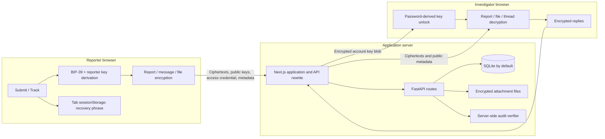

# Sealed technical review

Assessment date: **18 October 2026** (Asia/Qyzylorda). Reviewed revision: `d6ecdc4c516638f270c68a682db412a8577929f0`.

Scope: the local portfolio application, its frontend, backend, cryptographic code, models, tests, documentation, and Docker setup. This is an analysis-only review. Application source, dependencies, existing databases, and existing attachments were not changed. No commit or push was performed.

Evidence labels used below:

- **Reproduced:** observed using synthetic inputs against the actual module or an isolated API instance.
- **Code-confirmed:** directly established by source inspection; the affected browser interaction or database platform was not executed.
- **Risk/inference:** follows from a trust boundary or missing safeguard, but the particular attack or race was not exercised.

Source links are relative to this repository. Line numbers refer to the reviewed revision.

## 1. Executive summary

Sealed has a functioning encrypted reporting and conversation core. The browser generates recovery credentials, encrypts an initial report, encrypts attachments, derives the same reporter keys on return, and supports replies in both directions. Investigators can unlock the seeded key locally, decrypt reports, download attachments, and reply. **Anonymous two-way communication already exists in the frontend and API. Building a second chat system is not the next step.**

The cryptographic primitives work in the exercised happy paths and reject tested wrong keys and modified ciphertexts. The significant weaknesses are in the protocol and application boundaries surrounding those primitives:

1. **Investigator access is a browser key-unlock screen, not backend authentication.** Unauthenticated callers can list all cases, fetch threads, and submit investigator messages that change report status.
2. **Reporter-side message verification trusts the public key supplied with each message.** An outsider can create a valid, readable message with their own key and have it displayed as an investigator reply. A reporter message can also be reflected back as an investigator message without changing its ciphertext.
3. **The audit badge overstates what is verified.** Changing a report, message, or current status leaves the existing audit chain valid. Verification happens on the same server being described as untrusted; the browser does not independently verify a history or trusted checkpoint.
4. **The advertised attachment range is broken.** A plaintext file of 5 MiB or more selects the 10 MiB padding bucket. Encryption adds a 16-byte tag, exceeding the API's 10 MiB ciphertext limit. The effective maximum accepted plaintext is 5,242,879 bytes.
5. **Submission can succeed without giving the reporter their recovery phrase.** The browser writes to `sessionStorage` after the server commits but before displaying the phrase. A storage exception is reported as a submission failure and the phrase is not displayed. Retries and interrupted uploads also lack reconciliation.

Other concrete issues include attachment ownership checks, a stored bearer credential being accepted verbatim, weak API format validation, stale frontend session state after a failed lookup, and audit hashes that exceed their declared database column lengths.

The current `npm test`, frontend lint, frontend typecheck, and **default Turbopack production build passed during this assessment**. Existing API assertions also passed in an isolated harness. Those passes do not establish authorization, sender identity, audit completeness, or the advertised file-size support: the existing tests do not exercise those properties adequately.

For a local portfolio project, the best investment is a defensible core protocol, reliable recovery and file handling, explicit access boundaries, and tests of the actual frontend crypto module. Cloud infrastructure, public hosting, Kubernetes, and large-scale operations are outside this roadmap.

## 2. Actual architecture

### 2.1 Components and trust boundaries



- **Frontend:** Next.js 16.3.8 App Router, React 19, TypeScript, Tailwind CSS 4, Lucide, `bip39`, and `libsodium-wrappers-sumo`. The report page orchestrates submission; session hooks orchestrate tracking and investigator operations; shared components render conversations and attachments.
- **Backend:** FastAPI, Pydantic DTOs, synchronous SQLAlchemy sessions, SlowAPI request limits, and a filesystem attachment store. The async upload route also performs synchronous file/database work.
- **Database:** `Investigator`, `Case`, `CaseMessage`, `CaseAttachment`, and `CaseAuditLog`. Schema creation uses `Base.metadata.create_all`; no migration system was found.
- **Transport:** the frontend normally calls same-origin `/api`, rewritten to `BACKEND_INTERNAL_URL`, defaulting to `http://127.0.0.1:8000`. There is no application protocol that authenticates server-delivered JavaScript or pins the investigator key.

Sources: [frontend configuration](frontend/next.config.ts#L3), [API client](frontend/src/lib/api.ts#L15), [database](database.py#L7), [startup](main.py#L19), [models](models.py#L24).

### 2.2 Submission and recovery credential generation

The actual submission sequence in [the Submit page](frontend/src/app/page.tsx#L42) is:

1. Reject an empty text draft and prevent a second submission while the current UI operation is pending.
2. Fetch the first investigator's public key from `/api/v1/investigators/public-key`.
3. Generate a new 12-word BIP-39 phrase and derive reporter secrets in the browser.
4. For each selected file, read the entire file, pad and encrypt it, and upload the ciphertext immediately. Replace the locally generated attachment ID with the server's UUID.
5. Pack report text and attachment metadata together, enforce the crypto module's final plaintext-size limit, and encrypt the payload to the investigator.
6. Generate a case UUID and POST the ciphertext, reporter public key, access-token hash, and optional attachment IDs.
7. After that request succeeds, save the phrase in `sessionStorage`, show the numbered words, and clear the draft.

The server creates an `OPEN` case, appends an audit entry, links any attachment IDs it can find, and commits. Missing attachment IDs are silently ignored; an existing attachment can be reassigned from another case. The API does not verify that the ciphertext is authentic encryption, nor could it decrypt the report to perform that check. It can, but currently does not, enforce many basic encoding and length constraints.

### 2.3 Where keys originate

The reporter derivation in [crypto.ts](frontend/src/lib/crypto.ts#L74) is:

```text
128 random entropy bits -> 12 BIP-39 words
words -> BIP-39 64-byte seed
master = keyed BLAKE2b-256(message=MASTER_SEED tag, key=BIP-39 seed)
box seed = keyed BLAKE2b-256(message=REPORTER_KEYPAIR tag, key=master)
reporter public/private keys = crypto_box_seed_keypair(box seed)
token = keyed BLAKE2b-256(message=CASE_ACCESS_TOKEN tag, key=master)
presented access credential = unkeyed BLAKE2b-256(token)
```

The installed `bip39` implementation uses PBKDF2-HMAC-SHA512 with 2,048 iterations and no additional passphrase in this call. Its seed expansion does not increase the original phrase's 128 bits of generated entropy. Domain tags separate the reporter key and token derivations. The phrase is trimmed and lowercased, but internal whitespace is not normalized.

The live application does **not** provision investigator keys. [seed.py](seed.py#L18) inserts a fixed demo public key, password-encrypted private-key blob, salt, nonce, and Argon2id parameters. [poc.ts](poc.ts#L158) can generate fresh investigator keypairs in a separate simulation, but there is no corresponding application registration, password-change, key-rotation, or recovery API/UI.

For the seeded account, the password-derived key uses Argon2id with ops limit 2, 64 MiB memory, and algorithm identifier 2. That key decrypts a 32-byte investigator private key through `crypto_secretbox_open_easy`. Unlocking is local and creates no backend session.

### 2.4 Encryption and decryption

| Object | Implemented construction | Who can decrypt with the intended keys |
| --- | --- | --- |
| Initial report | ISO/IEC 7816-4 padding to a multiple of 4,096 bytes, then `crypto_box_seal` | Investigator holding the matching private key |
| Conversation messages, either direction | Padding to a multiple of 4,096 bytes, then `crypto_box_easy` with a fresh random 24-byte nonce | Both members of the reporter/investigator keypair exchange |
| Attachment | Strictly larger selected size bucket, fresh random 32-byte key and 24-byte nonce, then `crypto_secretbox_easy` | Recipient who decrypts the enclosing report/message metadata |
| Investigator private-key blob | Argon2id-derived key and `crypto_secretbox_easy` | Someone who knows the correct password, or otherwise obtains the key |

`crypto_box` and `crypto_secretbox` here use **XSalsa20-Poly1305**, not XChaCha20-Poly1305. Sodium padding is **ISO/IEC 7816-4**, not PKCS#7. These are documentation corrections, not recommendations to replace functioning primitives. See the primary [secretbox documentation](https://doc.libsodium.org/secret-key_cryptography/secretbox) and [padding documentation](https://doc.libsodium.org/padding).

Sealed boxes intentionally do not let the sender reconstruct the original plaintext later from their recovery phrase. Consequently Track does not retrieve or display the initial report or its initial attachments. It displays subsequent messages. This is a current product limitation that should be explained, rather than treated as a missing decryption key bug. See [sealed-box semantics](https://doc.libsodium.org/public-key_cryptography/sealed_boxes).

### 2.5 What the server stores and sees

The normal frontend does not send report text, attachment filenames/MIME types/file keys, the recovery phrase, the investigator's master password, or a plaintext private key.

The server does receive or store:

- Case IDs, a stable per-case reporter public key, the reusable presented access credential, report ciphertext, current status, and creation timestamps.
- Message ciphertexts, nonces, investigator public keys, sender labels, message IDs, case relationships, and timestamps.
- Attachment UUIDs, ciphertext sizes, disk paths, timestamps, and case relationships.
- Investigator usernames, public keys, encrypted private keys, salts, nonces, and password-KDF parameters.
- Audit event types, ordering metadata, timestamps, and hashes.
- Connection/request information at transport boundaries. The application uses client addresses for in-memory rate limiting and attempts to sanitize selected loggers; that is not network anonymity.

Encryption hides file metadata *inside the encrypted payload*, but does not strip identifying information embedded in documents or images from the investigator's eventual view. An arbitrary API caller can also upload plaintext bytes: the blind API cannot establish that every stored blob is encrypted.

The default seeded password is included in the source and prefilled by the frontend. Thus the normal secrecy statement about a passive database/ciphertext dump needs an explicit demo-fixture exception: the shipped demo account can be unlocked using publicly available fixture material.

### 2.6 Tracking and two-way communication

[TrackReport](frontend/src/components/TrackReport.tsx#L25) mounts only on the client to avoid rendering a server-side empty session over a stored browser phrase. [useReporterCase](frontend/src/hooks/useReporterCase.ts#L124) re-derives keys, POSTs the presented access credential to `/cases/lookup`, obtains status and messages, and decrypts messages locally. The phrase itself is not sent to the API. `Clear session` removes the stored phrase and clears the current case/key state.

Reporter replies are already implemented in `/cases/{case_id}/messages` and `/cases/messages`; both check the presented credential and set status to `IN_REVIEW`. The UI uses the case-ID endpoint. Investigator replies are already implemented in `/investigators/cases/{case_id}/messages` and set status to `RESPONDED`. Both reply flows support encrypted attachments.

The investigator selects a ciphertext report from the list, decrypts its initial sealed payload, fetches and decrypts the thread, and sends replies encrypted to the case's stored reporter public key. There is no case-to-investigator ownership field or stored recipient-key version; the application effectively assumes one seeded investigator. Reporter follow-ups fetch the current first investigator key again.

### 2.7 Attachments, errors, and incomplete operations

[AttachmentPicker](frontend/src/components/AttachmentPicker.tsx#L33) rejects plaintext files at or above 10 MiB. It otherwise permits multiple files without a total-size/count budget. [The crypto module](frontend/src/lib/crypto.ts#L468) selects among 256 KiB, 1 MiB, 5 MiB, and 10 MiB buckets. Original filename, MIME type, file size, bucket size, symmetric key, nonce, and server attachment ID are placed inside the enclosing encrypted report/message.

Downloads fetch a ciphertext UUID without a credential. The browser decrypts it in memory, downloads through a temporary object URL, and revokes the URL later. The API uses UUID validation, path containment, `application/octet-stream`, attachment disposition, `nosniff`, and `no-store`. The browser also forces potentially active MIME types to octet-stream. No confirmed stored-XSS execution path was found in the reviewed rendering code.

Errors generally retain text/file drafts; individual message decryption errors become placeholder text. There are visible loading, success, validation, empty, and fallback states. However, the workflow is not a transaction across files, case creation, browser credential storage, and UI updates:

- A file upload can commit before a later file, encryption step, or report/message submission fails. Its key/metadata may then be lost, leaving an unreadable orphan.
- There is no request idempotency/reconciliation protocol for a response lost after commit. A retry generates a new case ID and phrase.
- A `sessionStorage` exception after a successful case POST prevents phrase display.
- The API client exposes text errors but discards structured HTTP status and has no timeout/cancellation policy.
- Failed tracking and audit refreshes can leave earlier successful state on screen.

## 3. Feature completion matrix

“Implemented” below describes actual functionality, not a claim that its security boundary is complete.

| Stage / capability | Completion | Evidence and practical limitation |
| --- | --- | --- |
| Report editor and submission feedback | Implemented | Required text, attachments, disabled/loading controls, progress stages, retained draft on ordinary failures. No final-payload preflight or commit reconciliation. |
| Initial client-side encryption | Implemented | Real frontend crypto round-trip passed; wrong recipient rejected. Identity/case context is not bound into a structured envelope. |
| Recovery phrase generation/display/copy | Implemented with a confirmed failure path | Twelve numbered words and copy fallback exist. Blocked storage after commit can prevent their display. No save-confirmation/recovery reconciliation. |
| Phrase-based lookup without case UUID | Implemented | Deterministic derivation and token-hash lookup exist. Correct words with double spaces fail despite a UI count of twelve. |
| Status tracking and conversation refresh | Implemented, partial lifecycle | Reporter sees status and messages. `IN_REVIEW` means reporter activity, not an explicit investigator review action. `CLOSED` is modeled/rendered but has no application transition. |
| Read original submitted report from Track | Missing by current design | Initial ciphertext is sealed only to the investigator; Track DTO does not return it. Initial attachment metadata is also unavailable to the returning reporter. |
| Anonymous reporter follow-up messages | Implemented | UI, hook, authenticated-encryption function, token-checked API routes, and status update all exist. |
| Investigator replies | Implemented with a broken authorization/identity boundary | UI and encryption work. Write endpoint requires no server authentication; reporter trusts a message-supplied public key. |
| Investigator local key unlock | Implemented | Seeded blob and correct password unlock; wrong password is rejected. Password is prefilled and retained in component state after locking. |
| Investigator backend authentication / ownership | Missing | No session, challenge, token dependency, or investigator ownership check on case/thread/write routes. |
| Investigator provisioning / password change / key rotation | Missing in application | A separate PoC generator and fixed seed exist. No live workflow, stable recipient association, or versioned key history. Multi-investigator support must not be assumed. |
| Initial and follow-up attachments | Implemented with confirmed boundary failures | Encryption/decryption works. Files at least 5 MiB are rejected after encryption; upload authorization/reassociation is incorrect; incomplete uploads are not reconciled. |
| Attachment download hardening | Implemented | Ciphertext download headers, UUID validation, path containment, local decryption, and safe-download MIME handling exist. Ciphertext access itself is public by UUID. |
| Audit generation and badge | Partially implemented / misleading assurance | Links among stored log rows are checked. Current business data, trusted history, and actual sender identity are not established. |
| Error and empty states | Implemented, incomplete state consistency | Visible notices/fallbacks exist. Failed lookup can retain the previous conversation with a newly derived key; stale audit results can survive a failed refresh. |
| Case closure and reopening | Missing | Enum/UI support exists, but there is no close/reopen endpoint, UI control, or policy for messages on closed cases. |
| Local Docker demonstration | Configuration implemented; runtime not verified | Compose validates. No backend data volumes are defined, so container recreation loses local DB/files. Ports publish beyond loopback by default. |

## 4. Cryptography and security findings

Severity is relative to the application's claimed privacy and integrity properties. These are correctness priorities for a local demonstration, not an assertion that this project is currently exposed publicly.

### S1 — Investigator APIs have no authentication or authorization

**High · reproduced.** [The investigator routes](routers/investigators.py#L75) only depend on a database session. Without any password, cookie, or authorization header, the isolated API returned `200` for the case list and `201` for an investigator message. That write changes status and appends audit events. Fetching a case's thread likewise has no credential requirement.

Unlocking a private key in the browser protects decryption only when the key/password are genuinely private. It does not authorize API reads or mutations. Case enumeration exposes IDs, public keys, timestamps, statuses, ciphertexts, and message counts, and makes UUID secrecy ineffective as a case access boundary.

**Required direction:** introduce a minimal, explicit server-side investigator identity and authorization model while keeping content decryption local. A separate server session credential or a dedicated signing/challenge identity are possible designs. Do not send the master encryption password to the backend merely to fill this gap, or treat an X25519 encryption key as an Ed25519 signing key.

### S2 — Message-supplied sender keys and unauthenticated role/context allow forgery

**High · reproduced against actual frontend crypto, combined with the API acceptance above.** [decryptInvestigatorResponse](frontend/src/lib/crypto.ts#L207) uses `record.investigatorPublicKey` supplied by the server/message. It does not compare it with an independently trusted investigator identity. [MessageThread](frontend/src/components/Conversation.tsx#L25) labels a message from the server's `senderType`/`sender` fields.

Two memory-only probes succeeded:

1. Generate an attacker keypair, encrypt arbitrary text to the public reporter key, and supply the attacker public key in the response record. The reporter's actual decryption function accepts the message. The public investigator-write route can store such a record as `INVESTIGATOR`.
2. Take a valid reporter follow-up ciphertext and nonce, reuse the genuine investigator public key, and relabel/repost it as an investigator response. The reporter decrypts the reflected text successfully.

The MAC is functioning: a bit-flipped ciphertext was rejected. The defect is what identity and context the application asks the MAC to establish. The primitive allows both communicating parties to decrypt their own messages and does not itself bind an application role. See [libsodium's authenticated-encryption semantics](https://doc.libsodium.org/public-key_cryptography/authenticated_encryption).

The initial encrypted report also does not bind its outer reporter public key or case ID into an explicit protocol envelope. **Code-confirmed risk:** a server/database adversary can alter the reply public key without invalidating that initial report; the investigator reply path then encrypts to the altered key. This particular full interaction was not executed.

**Required direction:** define a versioned, validated envelope with case, participants, recipient-key version/fingerprint, message identity, and direction; establish trusted participant keys independently of each message; reject replay/reflection. If verifiable authorship against the other participant or third parties is a requirement, use a suitably designed separate signature identity. A shared MAC is not non-repudiation.

### S3 — Audit verification does not verify the report's actual state or an independent history

**High · reproduced.** [verify_case_audit_chain](audit_service.py#L104) recomputes links from values already stored in audit rows. It never recomputes a payload digest from the current report, message, attachment bytes, or case status. [Case creation](routers/cases.py#L64) even puts a random string in the field named `encrypted_report_hash`. Message event payloads contain IDs, sender labels, and nonces, not the ciphertext digest.

Changing a synthetic case's report, current status, and stored message ciphertext left `is_valid=True`. Changing all sequence numbers also left verification valid. The existing test only corrupts an audit row's `payload_hash`; detecting that narrower change does not establish the README's stronger database-integrity claim.

**Code-confirmed limitations:** there is no sequence-contiguity check; an empty log is valid; no external/client-held head prevents suffix truncation or a complete rewrite. Hashing is unkeyed, so someone able to rewrite the database can recompute the chain. The [frontend](frontend/src/hooks/useReporterCase.ts#L86) asks `/audit-verify` for a Boolean and displays it; it does not receive and independently validate the chain against a trusted genesis/head. This is not protection from a malicious verifier and not non-repudiation.

**Required direction:** state the intended audit threat model, bind events to real data, enforce ordering, and distinguish server-reported consistency from independently checked integrity. Add a client-held checkpoint or authenticated receipt only if claiming detection of server-side history rewriting. Otherwise narrow the claim and badge accordingly.

### S4 — Attachment ownership and association are not enforced

**High for integrity/access boundaries · reproduced.** [upload_attachment](routers/cases.py#L113) accepts `case_id` without checking the accompanying credential. An upload to an existing case with an explicitly wrong token returned `201`. Supplying no token with a case ID is also allowed by the code, as used by the investigator UI without backend authentication.

[create_case](routers/cases.py#L76) accepts arbitrary existing attachment IDs and changes their `case_id`, even if already attached elsewhere. A synthetic second case successfully reassigned a first case's attachment. Unknown IDs were silently ignored. Downloading a ciphertext by UUID requires no authorization.

These defects do not, on their own, decrypt a correctly encrypted file: its key is still inside the encrypted message/report. They do permit association tampering, unauthorized additions, metadata inconsistencies, and resource consumption. The audit event for an upload also does not prove the file was included in a successfully committed encrypted message.

**Required direction:** define ownership for staged uploads, authorize case association, disallow reassignment, and finalize attachment references atomically with the parent operation. Decide explicitly whether public-by-UUID ciphertext download is an intentional capability model or should require case access.

### S5 — The shipped demo credentials defeat secrecy of the seeded account

**High against an unconditional confidentiality claim · reproduced; deliberate demo shortcut.** [seed.py](seed.py#L18) ships a fixed encrypted key blob and its password; [useInvestigatorSession](frontend/src/hooks/useInvestigatorSession.ts#L30) prefills that password into the client. The actual frontend unlock function decrypted the fixture, and the derived public key matched the seeded public key.

Consequently, someone who obtains this application's default ciphertexts also has everything needed in the source/client fixture to unlock the default investigator key. An “encrypted database dump is unreadable” claim is not true for this seeded configuration. Local portfolio status makes a documented demo mode reasonable; it does not make this configuration a proof of password secrecy.

**Required direction:** clearly separate disposable demo fixtures from locally generated user-owned accounts/keys, remove automatic credential prefill outside demo mode, and document the limits. There is no need for an external identity provider or cloud secrets service.

### S6 — The stored token hash is itself the reusable access credential

**Medium · code-confirmed.** The browser sends `caseAccessTokenHash`; the server stores and compares those exact bytes ([lookup](routers/cases.py#L270), [case access](routers/cases.py#L380)). A database reader can replay the stored value to authenticate as a reporter at the API layer. Preimage resistance prevents deriving the phrase/private key; it does not prevent replay of the value the API actually accepts.

This exposes status/thread metadata and permits reporter-authorized mutations with arbitrary supplied ciphertexts. It does not alone recover the original reporter private key. The unrestricted investigator routes already expose much of the same surface today.

**Required direction:** if bearer capabilities are retained, store a separate verifier hash of the *presented credential* rather than accepting the stored verifier itself. Define revocation/versioning and account for existing records before changing the protocol.

### S7 — Successful submission can lose the recovery phrase

**High reliability impact · reproduced with the actual handler and mocked API.** In [the submission handler](frontend/src/app/page.tsx#L85), `sessionStorage.setItem` precedes `setCreatedMnemonic` after the POST has succeeded. The probe made storage throw after a successful mock commit: one commit occurred, the phrase-display setter was never called, and an error was shown.

The same code generates a new phrase and case ID for every retry; a lost response after a real commit has no safe reconciliation path. The progress/error UI cannot distinguish “not committed” from “committed but confirmation was lost.”

**Required direction:** retain recovery material and operation identity across the commit boundary, make phrase display independent of optional storage, and add idempotent reconciliation. Specify how refresh, cancellation, and ambiguous network failures behave without silently persisting extra secrets.

### S8 — Attachment size contract fails for the entire largest bucket

**Medium · reproduced.** The frontend accepts plaintext below 10 MiB, but the backend's [limit](routers/cases.py#L120) applies to ciphertext bytes. Actual encryption/decryption probes produced:

| Plaintext bytes | Padded/encrypted bytes | API size contract |
| ---: | ---: | --- |
| 0 | 262,160 | Accepted size |
| 262,143 | 262,160 | Accepted size |
| 262,144 | 1,048,592 | Accepted size |
| 1,048,576 | 5,242,896 | Accepted size |
| 5,242,879 | 5,242,896 | Accepted size |
| 5,242,880 (5 MiB) | 10,485,776 | Rejected: `413` |
| 10,485,759 (under 10 MiB) | 10,485,776 | Rejected: `413` |

The isolated API confirmed `413` for 10,485,776 bytes. This affects initial and both kinds of follow-up attachments. The same workflow uploads files before checking the final 64 KiB packed message limit, so a long report or many metadata entries can strand already uploaded files.

**Required direction:** publish and enforce one plaintext/ciphertext budget that includes padding and authentication overhead. Preflight the complete payload and file set before uploads, then test all bucket boundaries.

### S9 — Validation and resource controls leave avoidable failure paths

**Medium · reproduced/code-confirmed.** [schemas.py](schemas.py#L25) mostly validates presence/minimum string length rather than UUID format, base64 shape, decoded key/nonce sizes, or bounded payload/attachment counts. The API accepted malformed public keys, nonces, and ciphertext strings. It also accepted a body `caseId` that differed from the investigator reply URL, then silently used the URL ID. Duplicate access hashes are permitted and lookup takes the first match.

A non-ASCII token presented to a known case produced `500` because `secrets.compare_digest` is used with unrestricted strings. Uploads read the complete multipart file before enforcing size; report/message bodies have no comparable application maximum. That is an avoidable memory/disk abuse surface, even for a local demo.

**Required direction:** strict format/size validation, consistent error DTOs, explicit body/path agreement or one source of truth, and bounded streaming/preflight. A blind backend need not decrypt content to validate these properties.

### S10 — Rate limiting trusts caller-controlled proxy headers

**Medium · reproduced at the API layer.** [get_real_client_ip](rate_limiter.py#L11) trusts `X-Forwarded-For` and `X-Real-IP` without a trusted-proxy boundary. After a lookup key was exhausted (`429`), changing the supplied forwarded address produced `200`.

The current [CORS policy](main.py#L56) also permits all origins/methods/headers and enables credentials. Cross-origin reachability of a local service depends on browser/network restrictions; it was not browser-exploited here. This policy is not a substitute for authentication. [Compose](docker-compose.yml#L8) publishes backend and frontend ports without a loopback binding, contrary to an assumption that a local project is necessarily reachable only by the local machine.

**Required direction:** trust forwarding headers only from a configured local proxy, otherwise use the actual peer address; restrict local origins and bind local demonstration ports appropriately. This is a small local configuration issue, not a reason to introduce production infrastructure.

### Other trust and secret-lifecycle limitations

- **Server-delivered code and key substitution — architectural risk:** the server supplies both JavaScript and investigator keys. There is no pinned key or out-of-band verification. Despite the README's “trust on first use” label, the application does not record and enforce a first-use pin. No malicious JavaScript was served in this review.
- **No complete anonymity — architectural limit:** encryption does not conceal traffic timing, connection metadata, stable per-case keys, statuses, or document contents identifying the author. The logger filter is an attempt to reduce selected application logs, not a network privacy layer.
- **No forward secrecy against later investigator-key compromise — architectural limit:** captured initial sealed reports remain decryptable with the matching long-term investigator private key. Static conversation keys and attachment keys inside those reports/messages have corresponding historical exposure. A ratchet is not a first-priority portfolio requirement; accurately document this limit.
- **Partial memory cleanup — code-confirmed:** intermediate reporter seeds and several decrypted buffers/KEKs are wiped; this is good. Submission-generated reporter secret arrays are not explicitly wiped, repeated lookups replace `activeSecrets` without wiping the earlier instance, and malformed key-blob decoding can throw before the KEK's `finally` block ([crypto.ts](frontend/src/lib/crypto.ts#L253)). Immutable strings, password state, downloaded plaintext files, clipboard contents, and `sessionStorage` cannot be described as comprehensively wiped.
- **No confirmed application XSS sink:** report/message strings are rendered as React text; reviewed code contains no `dangerouslySetInnerHTML`/`eval` path. Attachment metadata from decrypted JSON is not structurally validated, which can cause rendering/download failures. CSP and runtime payload validation would be defense in depth, not a fix for an XSS exploit established here.
- **Padding claims need correction:** report ciphertext lengths measured 4,144 bytes for 1 and 4,095 plaintext bytes, 8,240 for 4,096 bytes, and 69,680 for 65,536 bytes. Padding conceals length within buckets, not across all message sizes. `safeUnpad` also accepts unpadded data after padding failure; that is compatibility behavior rather than strict protocol validation.

## 5. Engineering quality assessment

### Backend and persistence

The repository has a manageable separation between DTOs, models, routers, database sessions, rate limiting, and audit helpers. SQLAlchemy queries are parameterized; mutation handlers generally use commit/rollback, and an upload file is removed if its own transaction fails. Download handling has useful concrete safeguards.

The main debt is correctness across boundaries:

- The two reporter reply endpoints duplicate mutation/audit logic, increasing the risk of future policy differences.
- Case creation, staging files, message creation, and browser recovery are separate operations without a shared finalization/retry model.
- No case-to-investigator/recipient-key relationship exists. Treat the current application as a single-investigator demo until the model says otherwise.
- **Audit schema mismatch:** `hashlib.blake2b(...).hexdigest()` returns 128 characters because no digest size is specified, while `payload_hash`, `prev_event_hash`, and `current_hash` are declared `String(64)` ([hash functions](audit_service.py#L20), [columns](models.py#L191)). This mismatch was measured. SQLite accepts the longer values; PostgreSQL's bounded `VARCHAR` would reject them. PostgreSQL was not executed, and no PostgreSQL driver is declared in `requirements.txt`.
- The isolated SQLite connection reported `PRAGMA foreign_keys=0`. Database-level foreign-key/cascade enforcement is not enabled by [database.py](database.py#L14). ORM cascades do not validate every direct insert or filesystem relationship.
- No migrations, unique `(case_id, sequence_number)` constraint, token-hash uniqueness constraint, or optimistic version field was found. `create_all` does not migrate existing schemas.
- **Concurrency risk, not stress-tested:** audit append reads the latest sequence and increments it without a per-case lock or uniqueness guarantee. Concurrent writes can contend or fork; case/message ordering uses timestamps without a tie-breaking sequence. A sequential passing test does not establish concurrency safety.
- The investigator list loads all cases and counts lazily loaded message relationships, creating an N+1 pattern. For local data this is secondary to authorization and transaction correctness.

### Frontend and user-state consistency

The shared shell, notices, attachment controls, message thread, and reply composer make the interface coherent. The crypto module is separate from the session hooks and presentation. The client-only tracking boundary avoids the earlier stored-session hydration problem without moving cryptography to the server.

The hooks still mix network work, key lifetime, decryption, audit state, and user-state transitions:

- **Failed lookup retains mixed state:** `lookupCase` installs newly derived secrets before API lookup, but does not clear the previous case/messages if that lookup fails ([useReporterCase](frontend/src/hooks/useReporterCase.ts#L132)). The previous conversation can remain displayed with a different active key. A later reply can target the old case with the new credential; its attachment upload is especially problematic because the backend ignores that credential when a case ID is supplied.
- **Stale audit result:** both audit-fetch functions retain a previous verification after an error; responses are not bound to an active case/request generation. An older green badge can survive a failed refresh or late response.
- **Partial investigator login:** account/private-key state is installed before fetching cases. If listing fails, `login` returns false but the unlocked dashboard branch can still render, hiding the login error. Locking clears the key/data but not the password input state.
- **Refresh is incomplete:** investigator Refresh reloads the case list, not the currently open thread. A new message count can appear while displayed messages remain stale until the report is selected again.
- Key lookup and decryption work has no cancellation/request-generation guard. Lock/clear operations during an outstanding request can be followed by a late state update. These races are code-inferred, not browser-reproduced in this assessment.
- Messages use decrypted text placeholders on failure rather than a typed integrity state. Decrypted attachment metadata is cast from JSON without validation; a malformed object can turn a message-level problem into a page fallback.
- UI word counting accepts arbitrary whitespace but the crypto validator does not. The size counter measures JavaScript characters, while the encrypted payload limit is UTF-8 bytes including attachment metadata.
- Reporters cannot review their original report after returning, and there is no close/reopen workflow. These limitations should be explicit in the local demonstration.

### Tests and documentation

`npm test` runs a standalone simulation, not the frontend crypto module or browser UI. `e2e.ts` calls a live API but uses the separate PoC classes and only the initial report/investigator reply path. Importing `poc.ts` also starts its simulation as a side effect.

`test_api.py` provides useful routing, DTO, token-rejection, file-header, rate-limit, and narrow audit-tampering checks. However, its ciphertext fixtures are often invalid placeholder strings, the padding test reimplements padding instead of invoking the frontend library, and its successful investigator writes explicitly expect no authentication. Passing this suite preserves some of the defects above. No checked-in browser/component test suite, actual frontend-crypto test suite, migration test suite, or coverage configuration was found.

Documentation describes the broad flow correctly, but overstates uniform padding, client audit verification, non-repudiation, database-dump secrecy for demo fixtures, and anonymity. It names XChaCha20 where the code uses XSalsa20, names `@scure/bip39` where the dependency is `bip39`, and offers a credential pair not inserted by the current seeder. The README's Node 18 setup also does not match the installed Next package's Node engine requirement. Documentation should describe the measured implementation and a clearly identified demo mode.

### Local Docker and reproducibility

The frontend uses a multi-stage, non-root runtime and disables Next telemetry in its image. The backend seeds before starting; the frontend build bakes in the backend rewrite target. Compose's public-key healthcheck is suitable for detecting a seeded backend.

There are no backend DB/attachment volumes. Stop/start of the same container is different from recreation: removing/recreating the container discards its writable-layer data. Add local persistence or explicitly label the environment disposable. Container names and host ports can also collide with an existing local instance. No containers were started or recreated during this review.

Python requirements use open-ended minimum versions without a lock, whereas npm lockfiles are present. A reproducible local demo would benefit from a documented, tested toolchain and exact backend dependency resolution; no dependency changes are proposed as part of this assessment.

## 6. Verified tests and checks

These results were executed during this assessment, not copied from the earlier redesign task.

Environment: Windows, Node `v22.20.0`, Python `3.10.6`; installed FastAPI `0.121.1`, Starlette `0.49.3`, SQLAlchemy `2.0.54`, Pydantic `2.12.4`, SlowAPI `0.1.10`, HTTPX `0.28.1`.

| Check | Execution / isolation | Result and limits |
| --- | --- | --- |
| Standalone PoC | Root `npm test` | Passed. Uses in-memory mock data and separate PoC crypto, not frontend journey coverage. |
| Frontend lint | `npm run lint` in `frontend` | Passed. No dependency installation. |
| Frontend typecheck | `node node_modules/typescript/bin/tsc --noEmit --incremental false` in `frontend` | Passed. No incremental cache requested. |
| Default production build | `NEXT_TELEMETRY_DISABLED=1`, then `npm run build` in `frontend` | Passed with Turbopack, including TypeScript and page generation. Existing multiple-lockfile/workspace-root warning remains. No Webpack fallback was needed this time. Generated build artifacts only. |
| Existing API assertions | `test_api.run_tests()` in a fresh in-memory SQLite `StaticPool`, temporary working directory/attachments; `Base.metadata.drop_all` explicitly disabled in the harness | Passed all **22 printed assertion groups**. The destructive default `python test_api.py` command was not run against existing data. |
| Actual frontend crypto | `crypto.ts` transpiled and loaded in memory using already installed TypeScript/libsodium; synthetic keys and byte arrays only | Passed deterministic recovery, seeded-key unlock, initial report and both reply directions, file round-trips at bucket boundaries, wrong-password/key rejection, and modified-ciphertext rejection. Also confirmed chosen sender-key acceptance, role reflection, double-space failure, and actual ciphertext sizes. This is module verification in Node, not a browser execution test. |
| Submission error boundary | Actual `handleSubmit` extracted in memory, with a mocked API and throwing storage stub | Confirmed commit-before-storage-failure and absent recovery-phrase display; no request or real report created. |
| Additional API/security probes | Separate synthetic cases in the isolated in-memory API | Confirmed unauthenticated investigator operations, wrong-token upload, cross-case attachment reassignment, ignored missing attachments, duplicate access hashes, valid audit after content/status/sequence mutation, non-ASCII token `500`, and forwarded-header limit bypass. |
| Compose validation | `docker compose config --quiet` | Passed configuration validation only. No image pull, container start, or volume operation. |
| Repository integrity | `git status --short` before writing this report | Clean after checks; source and lockfiles unchanged. |

The first isolated API harness completed its assertions but encountered a Windows cleanup error because its temporary directory was still the process working directory. The harness was corrected to restore the original directory before cleanup, rerun successfully with exit code 0, and its temporary files were cleaned. This was a verification-harness issue, not an application test failure.

**Not executed:** the unguarded destructive API command; `npm run e2e` against the hardcoded live `127.0.0.1:8000` endpoint, which would create persistent cases; Docker builds/startup/recreation; PostgreSQL runtime tests; a new full browser journey; concurrency stress tests; comprehensive dependency-vulnerability scanning; malicious JavaScript delivery or real network anonymity testing. These omissions are not reported as passes.

## 7. Recommended milestones

The sequence below is for one local portfolio application. Keep the existing working two-way communication and visual shell; do not add a parallel messaging product or unrelated dashboards.

### Milestone 1 — Establish real API access boundaries

**Objective:** make investigator access and attachment mutation enforceable independently of the browser UI.

**Exact scope:** choose and document a minimal investigator server-authentication mechanism distinct from the password used to decrypt the private key; authorize case/thread reads and investigator writes; define the single-investigator ownership policy; authorize attachment staging/finalization and disallow cross-case reassignment; make the reporter credential's stored verifier different from the presented bearer value; validate IDs, base64 sizes, body/path consistency, and bounded inputs. Keep demo credentials explicitly opt-in. Configure trusted local proxy/origin/loopback behavior.

**Relevant modules:** `routers/investigators.py`, `routers/cases.py`, `schemas.py`, `models.py`, `main.py`, `rate_limiter.py`, `seed.py`, `frontend/src/lib/api.ts`, both session hooks, `docker-compose.yml`, and API tests.

**Acceptance criteria:** unauthenticated investigator reads/writes fail; authorized operations still support the existing encrypted journey; wrong-case/absent attachment credentials fail; an already assigned attachment cannot move; malformed inputs return stable `4xx` errors instead of `500`; changing an untrusted forwarded header does not reset a direct client's limit; stored verifier replay is rejected; no master decryption password or plaintext key is sent to the server.

**Complexity:** Large. **Dependencies:** none. Approve the authentication/capability design before implementation.

### Milestone 2 — Specify and enforce the encrypted protocol

**Objective:** distinguish successful decryption from verified identity, case context, and message direction.

**Exact scope:** document a versioned encrypted envelope; bind the case and participant/reply-key context to the initial report; establish a trusted investigator identity/key rather than accepting per-message substitutions; bind message IDs/direction and reject replay/reflection; validate decrypted payload and attachment metadata; normalize recovery input consistently; define explicit legacy-record handling. Decide whether local key unlock alone or separate signatures are needed for the stated authorship threat model. Add deterministic test vectors against the actual frontend crypto module.

**Relevant modules:** `frontend/src/lib/crypto.ts`, `frontend/src/lib/types.ts`, `frontend/src/hooks/useReporterCase.ts`, `frontend/src/hooks/useInvestigatorSession.ts`, `frontend/src/components/Conversation.tsx`, `schemas.py`, case/investigator models and DTOs, and protocol documentation/tests.

**Acceptance criteria:** the actual current chosen-key forgery and reflected-message probes fail; trusted genuine replies in both directions still decrypt; wrong case/key context and repeated message IDs are rejected; bit-flips remain rejected; both participants handle versioned records predictably; whitespace normalization recovers the same intended phrase; documentation accurately states padding, algorithms, trust assumptions, and authorship limits.

**Complexity:** Large. **Dependencies:** Milestone 1's identity and ownership decisions. Do not replace cryptographic algorithms without a specific protocol reason and compatibility plan.

### Milestone 3 — Make submission, recovery, and files reliable

**Objective:** ensure a successful report always has usable recovery credentials and a retry cannot silently create an unrelated duplicate.

**Exact scope:** explicit submission/finalization state machine; stable operation/case identity across ambiguous retries; idempotent commit/reconciliation; phrase display independent of optional tab storage; deliberate recovery UX for refresh/storage failure; preflight the UTF-8 packed payload and total attachment budget; align file-size rules with padding/MAC overhead; stage/finalize or clean up failed uploads using a local mechanism. Apply the same attachment/retry contract to both reply flows.

**Relevant modules:** `frontend/src/app/page.tsx`, `frontend/src/components/AttachmentPicker.tsx`, `frontend/src/lib/crypto.ts`, `frontend/src/lib/api.ts`, both hooks, `routers/cases.py`, `schemas.py`, attachment/case models, and failure-path tests.

**Acceptance criteria:** a storage exception after a committed POST still exposes the correct phrase; a lost response can be reconciled to one case with the same credentials; failed multi-file submissions do not leave permanent unowned blobs; the advertised file range really works at every boundary, including 5 MiB and the chosen maximum; final message-size failures occur before uploading files; cancellations/retries retain exactly the secrets/draft state described by the design.

**Complexity:** Medium–Large. **Dependencies:** Milestone 1's staged-upload ownership and Milestone 2's envelope/size contract.

### Milestone 4 — Make audit and persistence claims testable

**Objective:** provide meaningful evidence of history/state consistency and a schema that behaves as documented.

**Exact scope:** choose an audit digest size and migrate its columns consistently; define canonical event data bound to actual ciphertexts/status/file digests; serialize per-case append or enforce an equivalent atomic ordering policy with unique sequence constraints; verify sequence continuity; define what empty/truncated history means; expose sufficient evidence for any claimed client verification and specify a trusted-head/receipt mechanism if server rewrite detection is claimed. Add schema migrations and SQLite foreign-key enforcement. Scope PostgreSQL support honestly; either test/fix it or document SQLite-only support.

**Relevant modules:** `audit_service.py`, `models.py`, `database.py`, both routers, new migration files, `frontend/src/lib/api.ts`, `frontend/src/lib/types.ts`, `frontend/src/components/AuditBadge.tsx`, both hooks, and integrity/concurrency tests.

**Acceptance criteria:** report/message/status mutations are detected under the declared audit model; gaps and concurrent appends have defined, tested outcomes; the client cannot mistake a failed refresh for a newly verified green state; the chosen digest fits the schema; schema upgrades preserve existing local data; limitations against a completely malicious server are explicit. An unanchored server Boolean must not be presented as independently verified history.

**Complexity:** Large. **Dependencies:** Milestones 1–2 for authorized actors and stable record/envelope identity. Coordinate schema migrations with Milestone 3's operation model.

### Milestone 5 — Finish the local case lifecycle and regression demonstration

**Objective:** make the complete product journey repeatable, explainable, and safe to demonstrate locally.

**Exact scope:** close/reopen workflow with an explicit policy for replies to closed cases; selected-thread refresh; atomic frontend case/key/audit state transitions and cancellation guards; clear error categories; an end-to-end regression using actual frontend crypto and isolated API/storage; explicit reusable test fixtures; local container persistence/disposable-mode documentation; update README claims and setup/toolchain instructions. Remove PoC import side effects and keep the PoC as a teaching/demo entry point rather than the only crypto test.

**Relevant modules:** `frontend/src/components/TrackReport.tsx`, `frontend/src/app/investigator/page.tsx`, both hooks, conversation/audit components, `routers/cases.py`, `routers/investigators.py`, lifecycle DTOs/models, `test_api.py`, `e2e.ts`, `poc.ts`, `docker-compose.yml`, Dockerfiles, and READMEs.

**Acceptance criteria:** a repeatable isolated test covers Submit → credentials → Track → investigator decrypt/reply → reporter decrypt/follow-up → investigator read → close/reopen; refreshing a selected report refreshes its thread; failed lookup never mixes an old case with a new key; lock/clear cannot be undone by a late request; local data survives documented container recreation or the mode is clearly disposable; all default checks run without touching a developer's real database. Tests include the security and reliability regressions from this review.

**Complexity:** Medium–Large. **Dependencies:** Milestones 1–4. This milestone completes and demonstrates existing functionality; it does not introduce another chat system, cloud platform, or large-scale infrastructure.

## 8. Recommended next action

Approve **Milestone 1's minimal authentication/capability design** first, with the current unauthenticated investigator write and wrong-token attachment upload as the first failing regression cases. Agree that the local application remains single-investigator until an explicit recipient/key-ownership model exists.

Record the Milestone 2 protocol decisions alongside that design before changing encryption formats. If implementation is split into smaller changes, keep the forged-key/reflection probes and recovery-storage failure visible as open acceptance criteria rather than treating a passing happy-path test as completion.

Do not prioritize deployment infrastructure or new product features while these correctness gaps remain. **No implementation is included in this report. Work should resume only after approval.**
